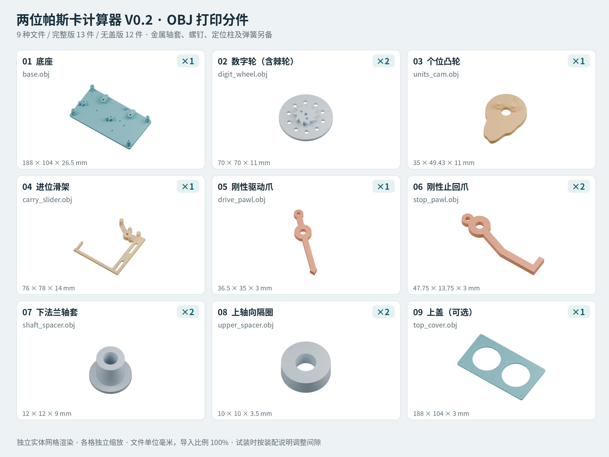

# 两位帕斯卡计算器 V0.2 · OBJ 打印交付

本仓库用于跨 Codex 环境恢复项目。先读 [项目上下文](docs/PROJECT_CONTEXT.md)；新环境执行步骤见 [重建说明](docs/REPRODUCE.md)，可复制提示词见 [CODEX_PROMPTS.md](docs/CODEX_PROMPTS.md)。

```bash
python3 tools/verify_baseline.py
python3 -m unittest discover -s software -v
```

以上两项只需要 Python 标准库，不修改打印文件。完整原交付包为 [pascaline-v2-print-obj.zip](dist/pascaline-v2-print-obj.zip)，分件预览见下图。



本版修订了 V0.1 的塑料弹片、缺少滑块支承及进位行程余量问题。全部打印件为刚性件；配套金属套管、紧固件、钢珠定位柱和外置回位弹簧构成完整机构。

## 打印入口

- `obj/`（下载打印包）或 `exports/obj/`（工作目录）：9 个独立 OBJ 文件，完整机按清单打印 13 件；省去可选盖板为 12 件。
- `exports/parts.csv`：数量、毫米尺寸、可选件标记。数字轮、止回爪、上下轴套/隔圈都各打印 2 件；其余各 1 件。
- `ASSEMBLY.md`、`HARDWARE.csv`：必须配套使用的装配说明与五金规格。
- `exports/print_parts_overview.png`：新版各零件的真实网格预览。
- `pascaline.scad`：可修改的建模源文件。

OBJ 是毫米坐标、单对象、封闭三角网格，无外部材质依赖。OBJ 格式本身没有强制单位；上传后选择毫米、100% 比例，并核对底座为 **188×104×26.5 mm**、数字轮为 **70×70×11 mm**。同一个文件的多个副本通过下单数量指定，不把整机拼为一个对象。

刚性件可优先询价嘉立创 9600 白树脂。零件表面不加厚涂层；保护齿面、凸轮、孔和滑槽，清理残留支撑。小孔与导槽需要按购入五金实测修整，本版不承诺出厂免加工装配。保留完整尺寸，不整体缩放。

## 落实的结构修订

1. 三只爪改为 **3 mm 厚的刚性转动爪、3.5 mm 宽圆角臂**，使用金属转轴套和外置弹簧，不再依靠 1.2 mm 树脂片弯曲。驱动爪尾臂止挡限制开角至 15°；止回爪使用外绕轮廓并保留约 0.85°名义反向间隙。
2. 滑块改用沿运动方向间隔 36 mm 的两处金属导向。下方 1 mm 垫片补齐支承高度，上方垫片控制浮动；螺钉夹紧金属套管，通过螺母紧固，不攻丝撑紧细树脂柱。轮轴和固定下轴套按说明校直并胶固。
3. 棘齿尖半径增至 17 mm；工作峰值位移 10.4 mm，超过原理想 9.082 mm。随后退让至 8.3 mm，由两只外购钢珠定位柱配合盘底 10 个凹位完成整格定位。另设 −4.5 mm 回程和 8→9 期间的预行程，让刚性驱动爪能够连续越齿并闭合。

两位布局仍为左个位、右十位；读数先读右侧十位。只允许正向逆时针拨轮，一次操作一个轮。无盖时贴固定读数箭头；首次装配先验证无盖版本。

## 验证范围

已执行独立网格检查、OBJ 往返读取比对、名义二维工作/回程几何检查、凸轮接触采样及装配截面检查。网格与几何结果在 `validation_summary.json` 和配套报告中。

这是一套完成上述设计修订、可交付打印打样的文件，**尚未实际打印或实物运转验证**。几何检查不等于弹簧力、摩擦、公差、强度及寿命验证；第一次装配必须按 `ASSEMBLY.md` 完成间隙调整和慢速进位测试。不要把外购弹簧、金属导向或钢珠定位柱省略后视为同一机构。

## 重新生成

按重建说明安装 OpenSCAD、Python 依赖后，在新目录生成：

```bash
python3 tools/rebuild.py --output /tmp/pascaline-rebuild --meshes --geometry
```

网格导出脚本仅使用 Python 标准库；几何验证需要 NumPy、Shapely 和 OpenSCAD。添加 `--preview` 可用 Blender 4.x 和 Noto CJK 字体重绘分件图。输出目录必须尚不存在。底层 `tools/export_parts.py`、`tools/export_obj.py` 会原地更新输出，日常复现优先使用上述独立目录入口。

任何参数修改后都必须重新生成并检查间隙，旧报告只对应记录的源文件哈希。二维几何脚本部分尺寸为独立编码；`--geometry` 会拒绝未经同步的 CAD 新版本。

## 配套程序与历史资料

`software/simulator.py` 是独立算术核心，只需 Python 标准库；支持 1～12 位，V0.2 机械模型仍为两位。运行示例：

```bash
python3 software/simulator.py --digits 2 --start 8 --add 7
```

软件事件、归零和溢出不是实体机构的动力学仿真或功能承诺。原 V1 静态姿态工具、旧设计与原理图保留在 `archive/v1/`，其中的打印和成本说明仅作历史参考。当前交付采用仓库根目录的 V0.2 文件。
